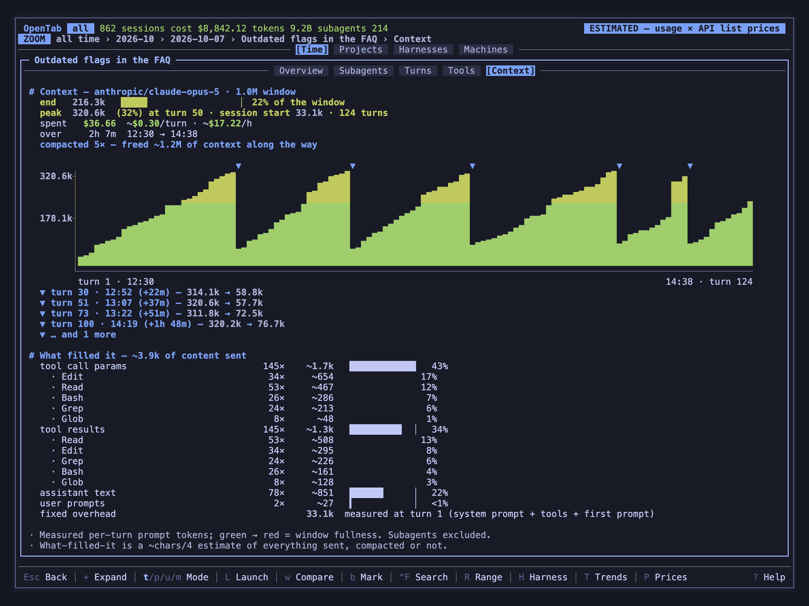
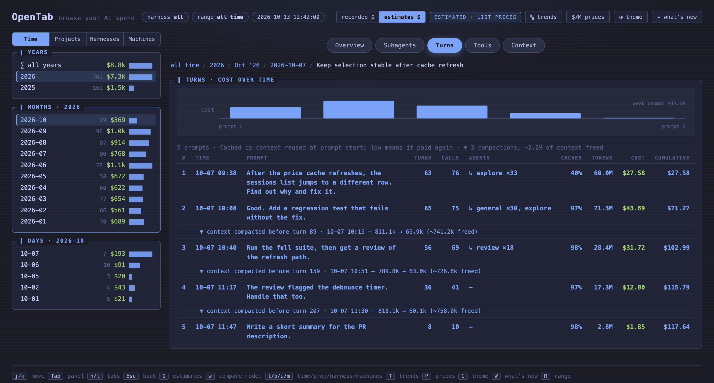

<h1 align="center"><a href="https://opentab.hamidi.dev">OpenTab</a></h1>

<p align="center"><em>Your AI coding tools keep a tab. OpenTab opens it.</em></p>

<p align="center"><strong>See where your coding agents spent their tokens, time, and money.</strong></p>

<p align="center">
  <a href="https://github.com/hamidi-dev/opentab/actions/workflows/ci.yml"></a>
  <a href="https://github.com/hamidi-dev/opentab/actions/workflows/ci.yml"></a>
  <a href="https://pypi.org/project/opentab-ai/"></a>
  <a href="https://pepy.tech/projects/opentab-ai"></a>
  
  
  
  <a href="https://github.com/hamidi-dev/opentab/blob/main/LICENSE"></a>
</p>

OpenTab brings the history your tools already keep into one interactive browser.
Follow a busy month into a project, a session, its subagents, and individual turns.
See what filled the context window. Compare the same token usage at another model's prices.

Runs locally, in your **terminal or web browser**. No account, no telemetry, and your
agents' history stays read-only.

<p align="center">
  <a href="https://opentab.hamidi.dev/try/"><b>▶ Try it in your browser</b></a> ·
  <a href="https://opentab.hamidi.dev/docs/"><b>📖 Documentation</b></a> ·
  <a href="#try-it-on-your-own-history">Install</a> ·
  <a href="#the-tools-it-reads">Supported tools</a> ·
  <a href="#faq">FAQ</a> ·
  <a href="https://opentab.hamidi.dev/docs/#/changelog">Changelog</a>
</p>

<p align="center">
  <a href="https://github.com/user-attachments/assets/bd22fb0f-0a74-486b-a71e-2478ccf3b45d"></a>
  <br><sub><b>Follow one session. Then zoom out.</b> Walk one session from cost to subagents, tool calls, file changes and context, then every machine and the browser. Synthetic showcase data; click for the full 73-second video.</sub>
</p>

## The tools it reads

| Tool | Cost | Subagents | Turns | Traces | Tools | Context |
|------|------|:---:|:---:|:---:|:---:|:---:|
| [OpenCode](https://opencode.ai) | recorded | ✓ | ✓ | ✓ | ✓ | ✓ |
| [Claude Code](https://claude.com/claude-code) | estimated | ✓ | ✓ | ✓ | ✓ | ✓ |
| [Codex CLI](https://developers.openai.com/codex) | estimated | ✓ | ✓ | ✓ | ✓ | — |
| [GitHub Copilot CLI](https://github.com/github/copilot-cli) | mixed | ◐ | ✓ | ◐ | ◐ | ✓ |
| [Copilot Chat in VS Code](https://code.visualstudio.com/docs/copilot/chat/copilot-chat) | estimated | — | ✓ | — | — | ✓ |
| [Gemini CLI](https://github.com/google-gemini/gemini-cli) | estimated | ✓ | ✓ | ✓ | ✓ | ✓ |
| [Antigravity](https://antigravity.google/) | estimated | ✓ | ✓ | — | ✓ | ✓ |
| [Hermes Agent](https://hermes-agent.nousresearch.com/) | mixed | ✓ | ◐ | ◐ | ◐ | ◐ |
| [pi-agent](https://pi.dev) | mixed | — | ✓ | ✓ | ✓ | ✓ |
| [omp](https://omp.sh) | mixed | ✓ | ✓ | ✓ | ✓ | ✓ |
| [OpenClaw](https://github.com/openclaw/openclaw) | mixed | — | ✓ | ✓ | ✓ | ✓ |
| [zaly](https://github.com/folke/zaly) | mixed | — | ✓ | ✓ | ✓ | ✓ |
| Your own CSV / JSONL request logs | per row | — | ✓ | — | ◐ | ◐ |

Every tool feeds the overview, trends and sessions; the columns are the deeper views.
**Estimated** means the tool records tokens but no price, so OpenTab prices them at
list rates. ◐ depends on what the tool kept or how it is set up, and `opentab doctor`
finds the gaps. [Footnotes, data locations, and setup](https://opentab.hamidi.dev/docs/#/sources)

> [!TIP]
> Claude Code and Gemini CLI delete local records after **30 days** by default, and
> OpenTab can only show what remains on disk. [Keep a longer history](#keep-your-history).

## Try it on your own history

<a id="install"></a>

```sh
pipx install opentab-ai
opentab
```

Start with a recent day, open **Sessions**, and pick one you remember. **Enter** drills
in, **Esc** steps back, **?** shows the keys that work where you are. The mouse works too.

On a subscription? OpenTab starts with clearly labeled API-equivalent estimates for
tokens that have no recorded cost; **`$`** switches to recorded spend.
[How the money works](#about-the-money).

Python **3.9+** · macOS · Linux · WSL · native Windows.

<details>
<summary><strong>More ways to install and upgrade</strong></summary>

The PyPI package is **`opentab-ai`**; the command is **`opentab`**.

```sh
brew install hamidi-dev/tap/opentab         # Homebrew (macOS / Linux)
pip install --user opentab-ai               # pip
curl -fsSL https://opentab.hamidi.dev/install.sh | bash
```

Upgrade with `pipx upgrade opentab-ai`, `brew upgrade opentab`, or
`pip install -U --user opentab-ai`.

The runtime uses Python's standard library, with `windows-curses` added automatically
on native Windows. [Windows & WSL setup](https://opentab.hamidi.dev/docs/#/windows).

</details>

<a id="usage"></a>

**New here?** Read the [Quick start](https://opentab.hamidi.dev/docs/#/quick-start).
Prefer a browser? **`opentab web`**. Sharing your screen? **`opentab --demo`**.
Scripting it? [JSON commands and the MCP server](https://opentab.hamidi.dev/docs/#/programmatic).

## Follow the work behind the numbers

<a id="what-you-get"></a>

**An expensive session, down to the turn.** Sort a day's sessions by cost and open the
biggest. **Subagents** splits its cost between the main agent and its delegates,
**Turns** lists each prompt with its tokens, cost and tool calls, and **Tools** groups
usage by tool and MCP server. **Worked** time drops the idle waits for your next prompt. [Sessions](https://opentab.hamidi.dev/docs/#/sessions)

**Why tokens and cost tell different stories.** **Token economics** puts each token
type's share of the volume beside its share of the cost: uncached input, output,
reasoning, cache reads, and cache writes.

**What filled the context window.** The **Context** view follows the window as it grows,
marks compactions, and estimates what went in.

<p align="center">
  
  <br><sub><b>Two compactions, and the context fills again.</b> The curve shows when; the breakdown shows what was sent. Anonymized demo data.</sub>
</p>

**Another model's prices on your actual usage.** Press **`w`**, pick a model, and open a
session to see its tokens priced at that model's list rates. **`P`** compares models and
providers using your own token mix, cache included. Token usage stays fixed: it is a
price comparison, not a prediction. [Pricing](https://opentab.hamidi.dev/docs/#/pricing)

## Built to be poked at

Daily, weekly and monthly trends, a calendar heatmap, and rankings of models, providers,
projects and tools. Follow any chart into the sessions behind it.

- **Tag** sessions by client or feature with **`Ctrl-T`**, then filter by `#client-x`. [Tags](https://opentab.hamidi.dev/docs/#/sessions#tags)
- **Find your way back** with bookmarks, notes, and **`L`** to reopen a session in its own tool.
- **See file edits** a session recorded in the **Changes** tab. [Changes](https://opentab.hamidi.dev/docs/#/changes)
- **Search past conversations** with **`Ctrl-F`**. Off until you opt in, since the index stores conversation text in plaintext. [Conversation search](https://opentab.hamidi.dev/docs/#/conversation-search)
- **Make it yours** with 30 themes, remappable keys and CSV export. [Configuration](https://opentab.hamidi.dev/docs/#/configuration) · [Keys](https://opentab.hamidi.dev/docs/#/keys)

[Watch the full narrated tour on YouTube](https://www.youtube.com/watch?v=EsJPw4y5zgU)

## In your terminal. In your browser. In one file.

```sh
opentab web                        # live browser on localhost
opentab --html report.html         # self-contained report, opens offline
opentab --demo --html demo.html    # anonymized for sharing
```

The browser shares the TUI's navigation, themes, trends and comparisons, and links to
months, days and sessions open the part you want to show. Raw traces and notes stay
out of exports unless you ask for them. [Web browser & exports](https://opentab.hamidi.dev/docs/#/web)

<p align="center">
  
  <br><sub><b>Keep exploring in the browser.</b> The same history, with familiar keys and clickable tables.</sub>
</p>

<a id="fleet"></a>

## Every machine, one tab

**`opentab machines pull`** gathers usage summaries from your other machines over SSH:
no background agent, no listening service, no raw traces.
[Managing machines](https://opentab.hamidi.dev/docs/#/machines)

## Live prices in your sidebar

[**herdr-opentab**](https://github.com/hamidi-dev/herdr-opentab) puts each running
agent's cost beside it in the [Herdr](https://herdr.dev) sidebar, subagents included.
For your own status bar, **`opentab cost "$PWD"`** prints the latest session's cost for
that project.

<details>
<summary><strong>See the Herdr integration</strong></summary>

<p align="center">
  
  <br><sub>Amounts synthetic, everything else real.</sub>
</p>

</details>

## About the money

**Recorded spend** comes from your tools' own records. A subscription session can record
millions of tokens and `$0.00`; your subscription is billed elsewhere.

**API-equivalent estimates** price that usage at list rates. They are on by default and
**`$`** toggles them. Rates ship in a bundled models.dev catalog, so browsing works
offline; refresh with `opentab --refresh-models`. Your invoice may still differ through
subscriptions, discounts or credits. [Pricing explained](https://opentab.hamidi.dev/docs/#/pricing)
## FAQ

<details>
<summary><strong>Does any of this leave my machine?</strong></summary>

Local browsing needs no cloud service or account and sends no telemetry. Your agents'
files are opened read-only; OpenTab writes its own preferences, notes, caches, and the
exports you request.

You control transfers: remote pulls fetch summaries from machines you choose, a price
refresh fetches the models.dev catalog, and exports go wherever you put them. The live
web browser binds to localhost by default. [Privacy details](https://opentab.hamidi.dev/docs/#/privacy).

</details>

<details>
<summary><strong>Can I show it without exposing my project names and prompts?</strong></summary>

Use `opentab --demo`, or **`D`** in-app, to anonymize titles, paths, prompt text, and
absolute spend/token numbers in memory. The shape of the data stays real. Demo mode
never writes those changes back to your history or saves your browsing state.

`opentab --demo --html demo.html` creates an anonymized report. You can also choose
which categories to scramble; [demo mode details](https://opentab.hamidi.dev/docs/#/privacy#demo-mode).

</details>

<a id="keep-your-history"></a>

<details>
<summary><strong>How do I keep a longer history?</strong></summary>

Claude Code deletes local transcripts after **30 days** by default, and Gemini CLI's
default retention removes chat recordings older than **30 days** on launch. Once the
source record disappears, its usage disappears from OpenTab too. OpenTab warns about
these settings; `opentab doctor` reports them.

For long history:

- Claude Code: add `"cleanupPeriodDays": 3650` to `$CLAUDE_CONFIG_DIR/settings.json`
  (default `~/.claude/settings.json`).
- Gemini CLI: set `"general": {"sessionRetention": {"enabled": false}}` in
  `~/.gemini/settings.json`, merging it with any existing `general` settings.

</details>

<details>
<summary><strong>My tool isn't supported. Can I still use OpenTab?</strong></summary>

If it can log API requests, point OpenTab at a CSV or JSONL of them. Turns, Tools, and
Context become available when the log carries the relevant optional fields.
[Request log schema](https://opentab.hamidi.dev/docs/#/sources#schema).

For another native integration, open an issue describing the tool and its record format.

</details>

## Something looks off?

Run **`opentab doctor`**. It reports which tools it found, why others are missing, and
what to fix, along with terminal support and the price catalog. It diagnoses without
repairing or reading transcript content.

[Full documentation](https://opentab.hamidi.dev/docs/#/index) · [Troubleshooting](https://opentab.hamidi.dev/docs/#/troubleshooting) ·
[Windows & WSL](https://opentab.hamidi.dev/docs/#/windows)

## Development

CI runs Ruff, unit tests, and ShellCheck. [CONTRIBUTING.md](https://github.com/hamidi-dev/opentab/blob/main/CONTRIBUTING.md) covers setup,
checks, and commit conventions; [Architecture](https://opentab.hamidi.dev/docs/#/architecture) explains the code.

## License

MIT — see [LICENSE](https://github.com/hamidi-dev/opentab/blob/main/LICENSE).
