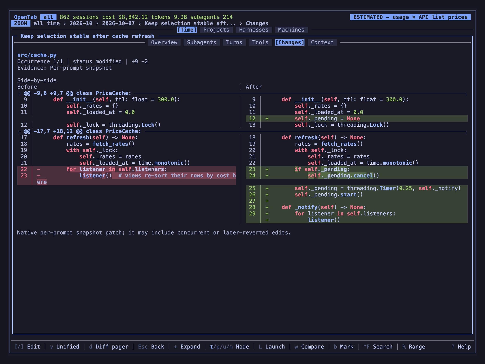

# Changes

The **Changes** tab lists the file edits a session recorded, with their diffs. It works for OpenCode and GitHub Copilot sessions.

Open a session with `Enter`, then switch to **Changes** with `h` / `l`. Select a file
and press `Enter` to read its diff.



## Two layouts

- **Side-by-side** (default): Before on the left, After on the right, with changed
  lines aligned.
- **Unified**: one column, deletions above additions.

Press `v` to switch. OpenTab remembers your choice. Below 80 columns it shows Unified
until the window is wide enough again.

## Keys

| Key | Action |
|-----|--------|
| `j` / `k`, `g` / `G` | Select a file; inside a diff, scroll |
| `Enter` | Open the selected file's diff |
| `v` | Switch between side-by-side and Unified |
| `[` / `]` | Previous / next recorded edit of the same file |
| `Space` / `Shift-Space` | Scroll half a page down / up |
| `d` | Open the diff in your own viewer ([see below](#use-your-own-diff-viewer)) |
| `r` | Reload, to pick up edits made since you opened the tab |
| `Esc` | Back to the file list |

`v` and `d` can be remapped as `diff_layout` and `diff_pager`
([Remap any key](configuration.md#remap-any-key)).

## The file list

| Column | Meaning |
|--------|---------|
| **Status** | What happened to the file, such as `added`, `modified`, `deleted` or `moved`; `mixed` when its records disagree |
| **Records** | How many times the file appears in the history (not unique edits) |
| **Diff** | Whether the diff text was kept: `yes`, `some` or `no` |
| **+Add / -Del** | Lines added and removed, summed over the records; `?` when records overlap |

## What gets recorded

| Harness | Source |
|---------|--------|
| OpenCode | Completed `apply_patch`, `edit` and `write` calls, plus a snapshot after each prompt |
| GitHub Copilot | Successful `edit`, `create`, `str_replace_editor` and `apply_patch` calls |

OpenTab shows what the harness kept. It never reads today's Git state and never
guesses from shell commands, so:

- Edits made by shell commands or formatters may be missing.
- A snapshot can include edits from other agents or from you.
- Edits that were later reverted still appear.
- A file with no records may still have been changed.

## Use your own diff viewer

Set `OPENTAB_DIFF_PAGER` before starting OpenTab, then press `d` inside a diff:

```sh
export OPENTAB_DIFF_PAGER='delta --paging=always --line-numbers'
```

The viewer gets the recorded patch on stdin. Quit it to return to OpenTab. Quoted
arguments work; pipes and shell expansions don't. Truncated patches stay in the
built-in viewer.

## Good to know

- Files and diffs load in the background; you can move elsewhere while they load.
- Loaded diffs stay in memory until you quit, reload (`r`) or change the harness.
- Very large histories and patches are cut short, with a note saying so.
- Changes is terminal-only. It is not in the web report, exports, the CLI or MCP,
  and it is hidden in demo mode.
