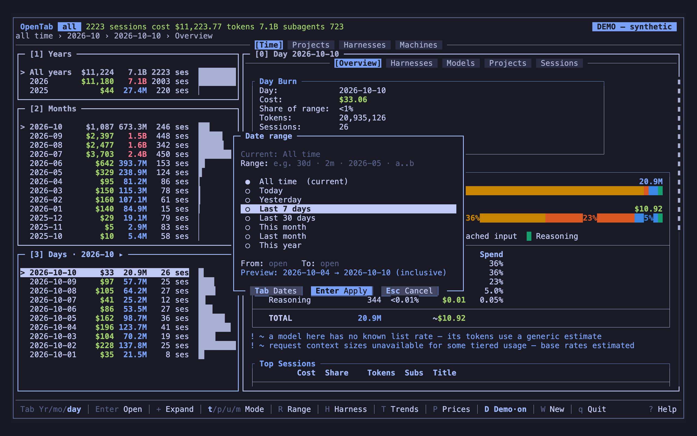
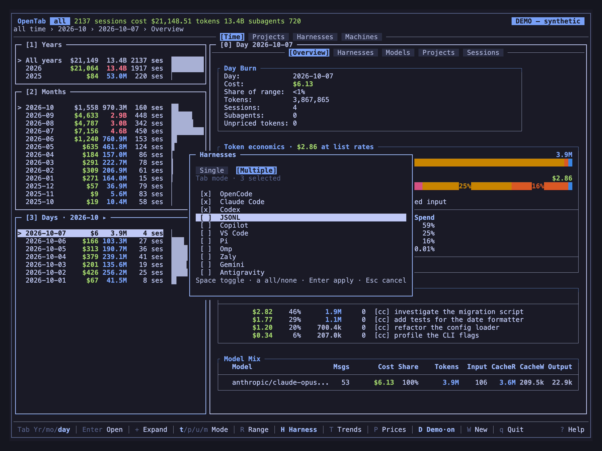

# Scope & filters

Narrow what OpenTab shows: a date range, a text filter over the current list, one or
more harnesses, or some machines. To search what was said in past conversations, use
[Conversation search](conversation-search.md) (`Ctrl-F`) instead.

## Pick a date range

Press `R`, type a range and press `Enter`. The preview line shows the exact dates
before you apply them.

| Type | Means |
|------|-------|
| `all` | All time |
| `30d` or `30` | From 30 days ago, with no end date |
| `2m` | This calendar month and the previous one, with no end date |
| `1y` | This calendar month and the 11 before it |
| `2026` / `2026-05` | That year / that month |
| `2026-05-01` | **Since** that date (not just that day) |
| `2026-05-01..2026-05-31` | From .. to; leave either side empty for an open end |

You can also pick a preset (Today, Yesterday, Last 7 / 30 days, This month, Last month,
This year, All time) or fill in **From** and **To** dates (`YYYY-MM-DD`).

| Key | Action |
|-----|--------|
| `Tab` / `Shift-Tab` | Move between Range, presets, From and To |
| `↓` / `↑` | From a field to the presets |
| `j` / `k`, `g` / `G` | Move in the presets |
| `/` | From the presets back to Range |
| `a` | All time (in the presets) |
| `Enter` | Apply what has focus: the typed range, the preset, or From..To |
| `Esc` | Cancel |
| `Ctrl-U` / `Ctrl-W` | Clear the field / delete a word |

With a preset selected, `a` resets to all time; in a text field it just types `a`.

Good to know:

- Dates use your local today, as of when the picker opened.
- Month and year presets cover the whole calendar period, including future days.
- The range is not remembered. Each launch starts on the default window, or on
  `--since`, `--until` or `--days` when you pass one.

## Filter a list

Press `f` or `/` and type. The list narrows as you type.

- **Sessions** match on title, project, ID and [note](sessions.md#working-with-sessions),
  ranked by how well they match. Matching is fuzzy, like fzf.
- **Projects** match the same way and keep their current sort.
- **Model lists** (`P`, `w`) match letters within a word, and a new word only at its
  first letter: `opus48` works, but `opus` doesn't match `qwen3-coder-plus`.

| Key | Action |
|-----|--------|
| `↑` / `↓` | Select while filtering |
| `Enter` | Keep the filter |
| `Esc` | Cancel |
| `Ctrl-U` | Clear the text |
| `x` | Clear the filter later |

## Sort a list

Press `s` for the sort picker, or click a column header (again to reverse). Each table
remembers its own sort, and the selected row stays under the cursor.

| List | Sort by |
|------|---------|
| Sessions | **Start Date** (default) or **Last Activity**, plus any column |
| Projects | **Recency** (newest session start) or **Last Activity**, plus any column |
| Models, Harnesses | Name, cost, tokens, message or session count, each token type |

With **Last Activity**, the Date column shows the latest activity, subagents included,
and its header reads "Last act". A session still belongs to the day it started.

## Choose harnesses

There are two ways to look at harnesses:

- **Compare them** with `u`: the sidebar lists every loaded harness with its cost,
  tokens and sessions. `Enter` opens one, within the current dates and machines.
- **Choose what loads** with `H`: pick one harness, or several on the **Multiple**
  tab. With several machines, this filters them by harness instead.

| Key (in `H`) | Action |
|--------------|--------|
| `Tab` | Single / Multiple |
| `j` / `k` | Move |
| `Space` | Toggle a harness (Multiple) |
| `a` | All / none (Multiple) |
| `Enter` | Apply |
| `Esc` | Cancel |

Your local harness choice is remembered between runs.

## Choose machines

With summaries from several machines ([Multiple machines](machines.md)), press `M` to
show only some of them. It uses the same keys as `H`. Machines and harnesses combine:
you see the selected harnesses on the selected machines.

The machine filter lasts for the current run. Choosing all machines clears it.

## Drill into a model

`Enter` on a row of the **Models** tab opens that model within what you're looking
at: the day, month, project or machine. It has two tabs:

- **Economics**: sessions and messages that used it, its tokens, and its spend split
  by token type.
- **Sessions**: the sessions that used it, with **Model list** and **Model tok**
  showing only this model's share. A cheap session that leaned on the model ranks
  above an expensive one that barely used it. `e` exports these columns too.

Costs here always use list rates, so token types compare fairly. A `~` marks a guessed
rate; local models have no list price. See [Token economics](pricing.md#token-economics).
`Esc` returns to the Models table.

**Trends → Models** opens the same two tabs for the active date range. See
[Trends](overlays.md#trends).
