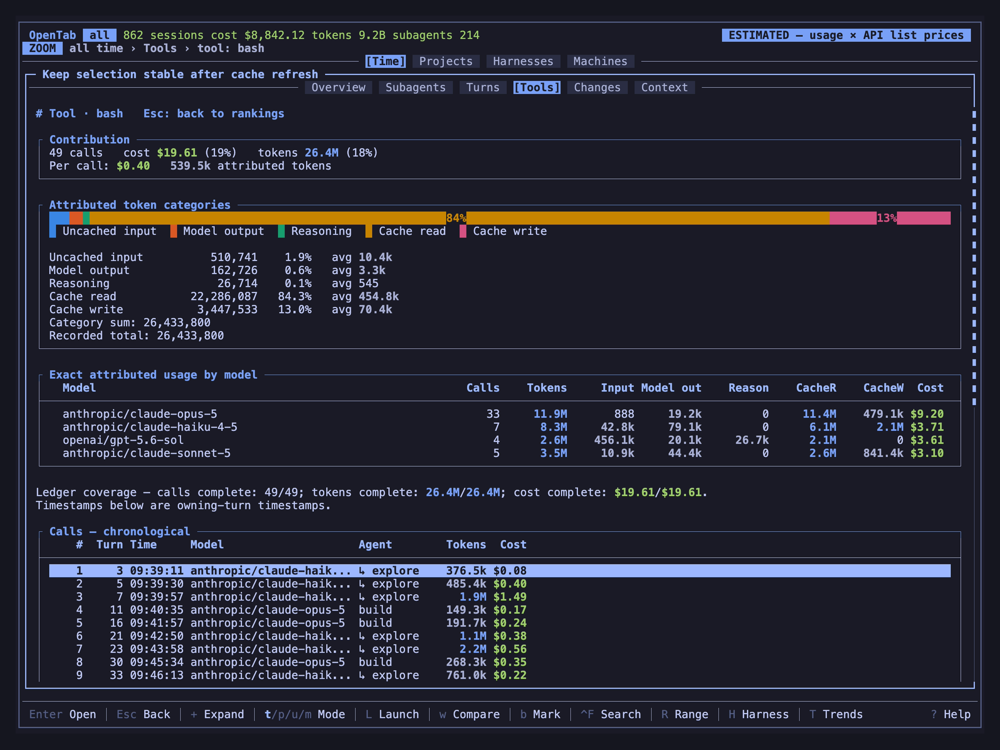
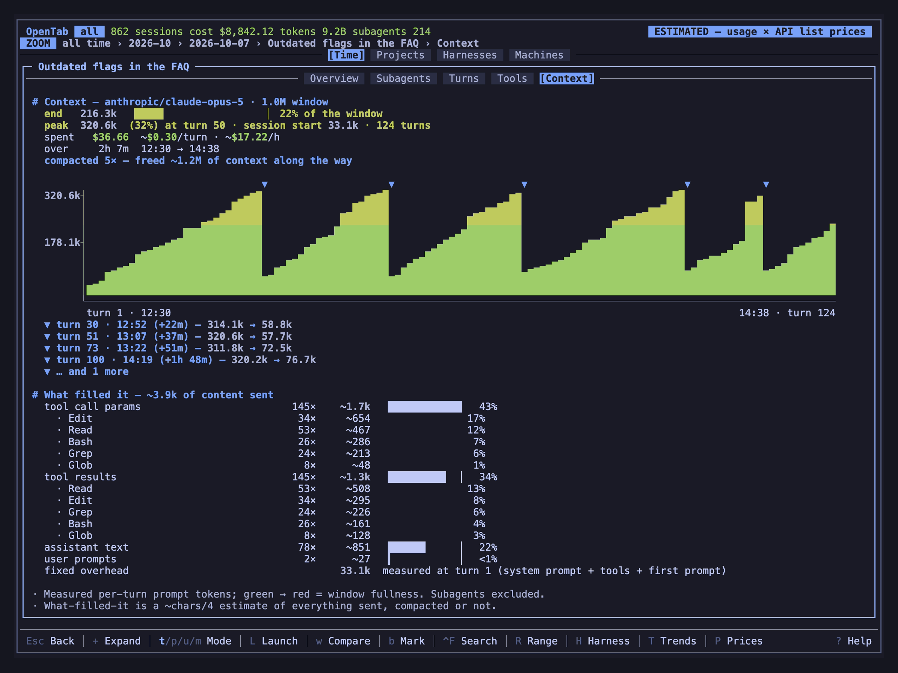

# Reading a session

A session is one conversation with an agent, from your first prompt to the last
answer, including the subagents it started. OpenTab shows what it cost, where the money
went, and what the agent did.

Select a session on a **Sessions** tab and press `Enter`. It opens full screen; `h` /
`l` switch its tabs and `Esc` steps back.

## Session tabs

| Tab | Shows |
|-----|-------|
| **Overview** | Cost, model mix, timing, worked time and your note |
| **Subagents** | Each delegated execution, its prompt, turns and cost |
| **Turns** | Every prompt you sent, what it cost, and each turn the agent took |
| **Tools** | Spend per tool and MCP server, and every call |
| **Changes** | Files the agent edited, with diffs ([Changes](changes.md)) |
| **Context** | How the context window filled up, and when it was compacted |

A tab appears when the session's harness records what it needs. See
[What each harness supports](sources.md#what-each-harness-supports).

## Turns

The Turns tab opens on your prompts, charted by total cost per prompt.

1. Select a prompt and press `Enter` to see its full text and the turns that answered
   it, with charts of cost per turn and context growth.
2. Select a turn and press `Enter` to read it: the model's text, its reasoning and each
   tool call, with arguments and output.

| Key | Prompts | Inside a prompt | Inside a turn |
|-----|---------|-----------------|---------------|
| `j` / `k` | Select a prompt | Select a turn | Scroll |
| `g` / `G` | First / last prompt | First / last turn | Top / bottom |
| `Enter` | Open the prompt | Open the turn | Expand / collapse the selected output |
| `[` / `]` | | | Previous / next turn of this prompt |
| `{` / `}` | | | Previous / next tool call |
| `c` | | | Pick a tool call from a list |
| `z` | | | Full recorded content / back to the preview |
| `Esc` | Back | Back to prompts | Back to the turn list |

Inside a turn, the prompt, the turn and the selected call stay pinned above the
transcript. Scrolling never changes which call is selected. Click a call's header,
arguments or result to select it; double-click toggles its output.

A turn first shows a short preview. Press `z` to load everything that was recorded;
the call picker (`c`) then lists every call too.

### Copy a tool call

| Key | Copies |
|-----|--------|
| `y` | The selected call as Markdown: tool, status, arguments, parameters and output |
| `Y` | Only the command or arguments; shell commands paste as plain text |
| `O` | Only the output, as plain text |

Copies always take the full recorded text, even when the call is collapsed. A
message confirms which call and part were copied. If that part is empty or wasn't
recorded, the clipboard stays as it was.

### Token breakdown

A prompt's or turn's detail shows its tokens by type, with exact counts.

- A prompt's total sums the turns that answered it, not the text you typed.
- One-hour cache writes are shown as part of all cache writes.
- Reasoning can read zero when the harness already counts it in output.

### Markers between turns

| Marker | Means |
|--------|-------|
| `▼` | The context was compacted before this turn, from how many tokens to how many |
| `❄` | The prompt cache expired while the session sat idle, so the turn paid for the context again ([Cache misses](pricing.md#cache-misses-are-estimates)) |
| `⚙` | Reasoning effort changed, which also dropped the cache |

The tab's title counts them. Markers stay visible when the prompts are folded. A marker
on a prompt's first turn sits above that prompt; a later one sits under it, indented.
Codex sessions show no compaction markers, because Codex logs running totals instead
of each request.

## Tools

The Tools tab ranks spend by tool, and by MCP server or namespace.

- `Enter` on a ranking opens it: its share, per-call averages, token mix and models.
- The call list below runs in time order. `Enter` on a call opens the prompt it
  belongs to with that turn selected; `Enter` again opens the turn.
- `Esc` steps back level by level, to the call and ranking you came from.
- `$` switches prices without losing your place.

Some harnesses only record totals per tool. Their rankings still work, and the tab
says that individual calls are unavailable. The Tools CSV export (`e`) is always the
per-tool totals.

## Subagents

The overview counts delegations and their share of the cost, by agent and by model.

- `j` / `k` select an execution, `g` / `G` the first or last.
- `Enter` opens it: a summary, the prompt it received, and its turns. Follow-up prompts
  appear as sections on the same page.
- `Enter` on a turn reads it, with the same keys as [Turns](#turns). `[` / `]` step
  through this execution's turns only.
- `z` shows full prompts, the full title, metadata and the exact token breakdown.
- `Esc` returns to the turns, then to the list, where you left it.

**Received prompt** is the first message the subagent got. It is not its full system
instructions or inherited context.

Opening an execution's turns works for OpenCode, Claude Code, Codex, omp, Copilot and
Hermes when the records survive. Gemini CLI, Antigravity and sessions on other
machines show the summary only. Each execution's model is the one it mostly used, not
proof it used only one. Its share comes from its own numbers, so shares can differ
slightly from the session total.

## Context

The Context tab charts how full the context window got, turn by turn, as a share of
the model's window. It also shows:

- each compaction, with its clock time and how far into the session it happened;
- what the session spent, per turn and per hour;
- its start and end time;
- an estimate of what filled the context, on harnesses whose logs include content.

## Turns from another machine

On a session from a machine you reach over SSH, opening a turn fetches it from that
machine ([Multiple machines](machines.md#read-a-remote-turn)). The header shows the
machine and the loading state.

- `Esc` closes the turn and cancels a fetch in progress. After an error, close and
  reopen it to retry.
- `[` / `]` fetch the neighbouring turn.
- Nothing is saved. Sessions imported from a URL or file can't fetch turns.

## Working with sessions

Every session list has a **Worked** column: the time the agent was actually working,
without the gaps where it waited for you. A session left open all afternoon may show
minutes. It is blank when the harness doesn't record your prompts separately, as with
Copilot's OpenTelemetry export or VS Code. The Overview spells it out:
`Started: … · worked 2h 15m (until 14:15)`.

| Key | Action |
|-----|--------|
| `i` / `I` | Ignore the selection / show ignored rows so you can unignore them |
| `b` / `B` | Bookmark ★ a session / show only bookmarks |
| `n` | Write a note ✎ on a session |
| `o` | Open its directory |
| `L` | Resume it in its own tool |
| `y` | Copy its conversation as Markdown |
| `e` | Export the current list to CSV in the working directory |

While ignored rows are shown with `I`, their usage counts in totals and prices again.

### Notes

A note records *why* a session cost what it did. Press `n`, type, and press `Enter`;
an empty note removes it. `Ctrl-U` clears the text, `Ctrl-W` deletes a word, `Esc`
cancels.

Noted sessions show `✎` in every list, and the note appears in the Overview. The
list filter (`f`) searches notes, and CSV exports include a `note` column. Notes are
saved immediately to `~/.local/share/opentab/notes.json` and are never deleted,
even when the session disappears. They are off in demo mode and with `--no-state`.

### Resume a session

`L` reopens the session in its own tool, such as `opencode --session`,
`claude --resume` or `codex resume`. Then choose where:

| Key | Opens in |
|-----|----------|
| `w` | A new window or tab |
| `s` | A split to the right |
| `v` | A split below |
| `p` | A popup |
| `y` | Nowhere: copy the command instead |

tmux offers all of them. Herdr offers the tab and both splits when it knows the
current pane (`HERDR_PANE_ID`), otherwise only the tab. Inside nested multiplexers,
the innermost one is used. To use something else, add a
[launcher hook](configuration.md#custom-launchers).

A session pulled from another machine reopens there over `ssh -t`, when that
machine's [saved connection](machines.md#saved-connections) has an SSH target. Without
one, `y` still copies the command.

### Copy a conversation

`y` copies the session's user and assistant messages as Markdown (`## User` /
`## Assistant`), in order and in full, code blocks included. It leaves out tool
calls, reasoning, system messages and attachments. Inside a turn, `y` copies the
selected tool call instead.

It works for OpenCode, Claude Code, Codex, Hermes, Copilot, pi and omp, and needs no
search index. Prompts hidden with `Ctrl-P` are copied as you wrote them.
It reads what the harness kept at that moment: deleted history is gone, and branches
or repeated prompts it kept can appear.

## Good to know

- Demo mode hides real prompts and content, and turns off copying.
- `Ctrl-P` swaps the prompts you typed for stand-ins without entering demo mode.
  See [Overlays](overlays.md#hide-your-prompts).
- Turn content is read when you open it, or when explicitly exporting a
  [web report with traces](web.md#raw-turn-traces-opt-in) through
  `--allow-raw-content`. It never enters summaries other machines pull. Reading it
  from scripts is opt-in; see [Raw content](programmatic.md#raw-content).
